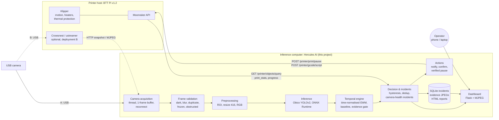

# Architecture and engineering decisions

## 1. System overview



ASCII version for the slides:

```
 camera ─► acquisition ─► validation ─► preprocessing ─► inference ─► temporal ─► decision ─► actions ─► Moonraker ─► Klipper
 (USB/     (thread,       (skip bad,    (ROI, 416²)      (ONNX,       analysis    (incident,  (notify,   (pause only)
  MJPEG)    latest only)   duplicates)                    ~0.1-0.3 s)  (EWM, gate) dedup)      pause)
                                                                                     │
                                                                  dashboard ◄────────┴──► SQLite + evidence + report
```

Every stage is a module with one job (`hercules/<stage>.py`). The same `Analyzer` object (`pipeline.py`) runs in the live service and in the offline evaluation. The measured numbers therefore describe the code that actually runs on the printer.

## 2. Options compared

| Option | What it means | Verdict |
| :--- | :--- | :--- |
| **1. Install Obico** (self-hosted server + moonraker-obico plugin) | Docker stack (Django, PostgreSQL, Redis, ML API) on the PC, plugin on the Pi | Works, but it is a large web platform (accounts, tunnelling, mobile app) around one model. The decision logic is tied to a fixed frame rate and to the server database. The parameters cannot be tuned or measured offline. We would only be installing someone else's product. |
| **2. Adapt Obico's detection component** | Reuse the pretrained network and its documented pre/post-processing, write the rest | **Chosen.** It keeps the only openly available model trained on large amounts of real spaghetti footage. Everything around it can be engineered and measured by us. |
| **3. Train our own detector** | Collect and label data, train a YOLO-class model | Not justified now. Public data is small, mixed and unevenly licensed (see RESEARCH), and we have no footage from our own printer yet. An independent 2026 study (3d-cli) fine-tuned several backbones and found no gain worth shipping over this model. The toolchain for doing it later is prepared: session-level splits, a recorder and a labelling helper. |

Other candidates we checked: PrintGuard (GPL-2.0, ShuffleNet prototypes) detected 0 of 22 real spaghetti frames in the 3d-cli study. Generic CLIP/DINO models need a GPU or are slow on a CPU, and work only as a second-stage verifier. Neither beats option 2 on our constraints: CPU-only, offline, defence in 9 days.

## 3. Design decisions

**Low-frequency inference instead of every frame.** A failure that matters (spaghetti, a detached part) develops over minutes, not milliseconds. The head moves constantly, so analysing every video frame mostly analyses motion blur. We measured detection latency and false alarms across inference intervals from 1.4 s to 22 s (EVALUATION § 3) instead of picking a value.

**Time-normalised temporal engine (ours).** Obico smooths the frame score with an EWM of span 12 *frames*. That is a different time window at 1 s and at 10 s per frame. We use `alpha = 1 − exp(−dt/τ)` with τ = 60 s, so the smoothing is a property of time, not of the frame rate. At long intervals a single frame moves the average a lot. An **evidence gate** therefore also requires ≥ 3 frames with p ≥ 0.2 within 120 s, which a single spike cannot satisfy. A slow baseline (τ = 1 h) absorbs constant background scores from a textured scene. It is **frozen while an incident is open**, so a failure cannot teach the baseline that spaghetti is normal. The warning (0.38) and critical (×1.75) levels are Obico's published tuned values. The window lengths and gate are our design, validated on recordings.

**One incident per failure.** An incident opens at the first warning, escalates once to critical, and closes only after the score has stayed below half the warning level for 2 minutes (hysteresis). A dismissed false alarm resets the engine and suppresses alerts for 10 minutes.

**Bounded single-frame buffer.** The camera thread overwrites one slot. The analyser always takes the newest frame, so slow inference never builds a backlog and the memory used does not grow. Frames that are never analysed are counted, not queued.

**Skip work that cannot help.** Unusable frames (dark, covered) are not sent to the network. Unchanged frames reuse the previous result. Motion-blurred frames, judged relative to this camera's own running sharpness, are skipped, at most 5 in a row so the monitor can never be starved.

**Camera health is a first-class failure.** A blind monitor is worse than none, because people trust it. Offline, stalled, frozen (bit-identical frames), obstructed and unusable lighting each open their own incident after a persistence time.

**Printer integration through documented endpoints only.** Moonraker is polled (`/printer/objects/query`) instead of using a websocket subscription. Polling is stateless and survives Moonraker and Klipper restarts without resubscribe logic, and the print state changes on a scale of seconds. A pause is sent with `/printer/print/pause` and **verified** by reading `print_stats.state == "paused"`. The client has no resume, cancel, temperature or motion method at all. If Moonraker is unreachable, monitoring continues and alerts still appear in the dashboard; only the pause is impossible, and the dashboard says so.

**Three pause policies.** `notify` (default) → `confirm` (a person presses Pause in the dashboard) → `auto`. Automatic pausing is off until detection has been validated on our own printer.

**Separate inference computer.** A Klipper host has to answer the MCU in real time. Measured CPU load is in EVALUATION. The service unit runs at `Nice=10` and `CPUWeight=20` with a memory cap, so even co-located it yields to Klipper. The recommended setup still keeps the network off the BTT Pi.

**Replays use the recording's clock.** The demo can replay a 55-minute print at 10× and the decision engine makes the same decisions at the same print times. This removes a whole class of "works in the demo but not live" errors.

## 4. What is ours and what is third-party

| Component | Origin | Licence |
| :--- | :--- | :--- |
| Neural network weights (YOLOv2, class "failure") | **Obico** / The Spaghetti Detective, downloaded at install, SHA-256 pinned | AGPL-3.0 (project licence) |
| Pre/post-processing constants (416×416, RGB/255, box floor 0.08, NMS 0.45) | Reproduced from Obico `ml_api/lib/onnx.py`, verified identical by a test | AGPL-3.0 reference |
| Warning threshold 0.38, escalation factor 1.75 | Obico `backend/config/settings.py` | — (numbers) |
| ONNX Runtime, OpenCV, Flask, waitress, psutil, requests, NumPy | Libraries | MIT / Apache-2.0 / BSD |
| Camera acquisition, reconnect, MJPEG parser, replay with media clock | **Hercules team** | |
| Frame validation (adaptive blur, frozen, obstruction, lighting) | **Hercules team** | |
| Time-normalised decision engine, evidence gate, frozen baseline, hysteresis, dismissal | **Hercules team** (inspired by Obico's EWM idea) | |
| Incident system, evidence, HTML/JSON reports | **Hercules team** | |
| Moonraker client with verified pause, mock Moonraker server | **Hercules team** | |
| Dashboard (UI, ROI editor, settings, live overlay) | **Hercules team** | |
| Evaluation method: session-level replay, onset labels, FA/hour, latency sweeps | **Hercules team** | |
| INT8 quantisation study, benchmarks, deployment (installer, systemd) | **Hercules team** | |
| Evaluation recordings | Zenodo record 18628777 (Prusa MK3 prints) | CC-BY-4.0 |
