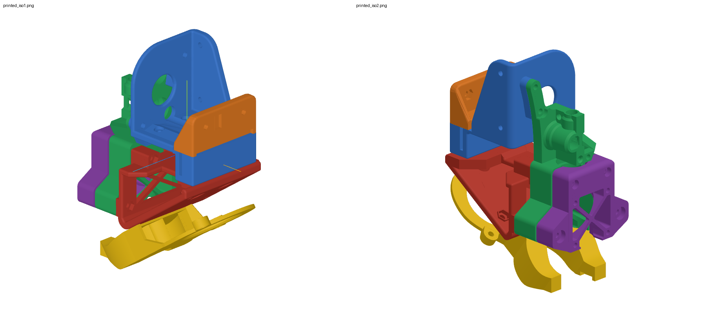
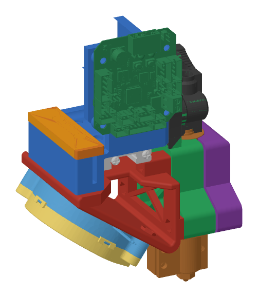
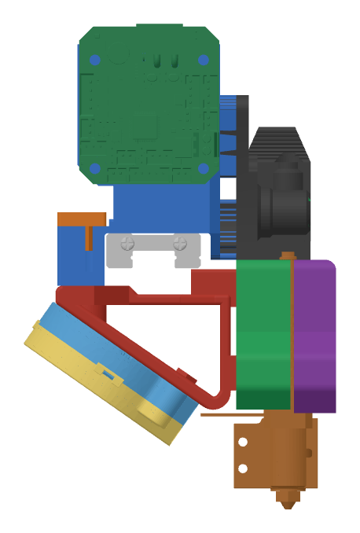
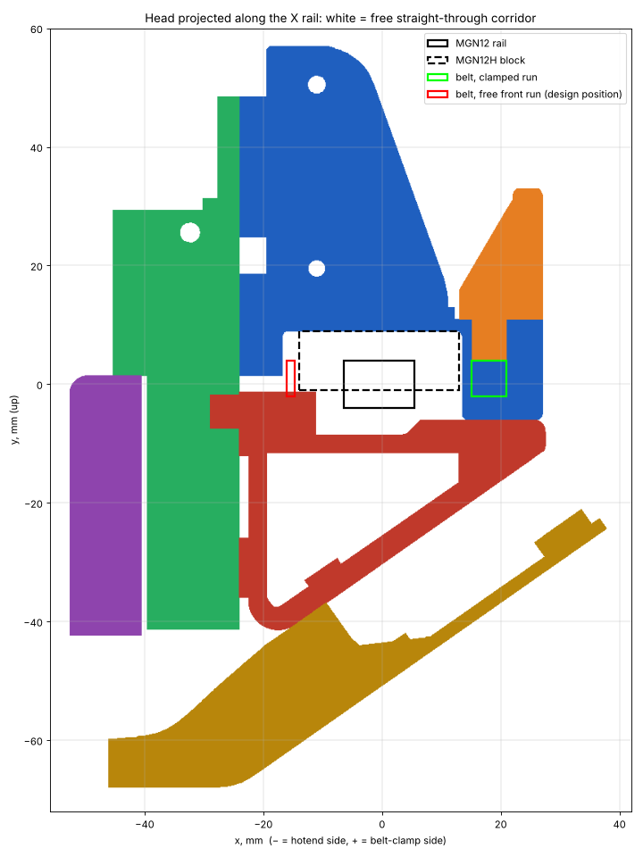

# Print head (Hefest) — review of the current design

Source: [KAPACbik/Hefest, branch `Side-PCB-test`](https://github.com/KAPACbik/Hefest/tree/Side-PCB-test), commit `006a50f` (Nov 13, 2026). This folder holds the analysis only; the CAD files stay in that repository.

## What is in the repository

The head is designed in KOMPAS-3D v23 (educational version). History: 12 commits, Nov 8–13, 2026; `main` stops at Nov 9 and all later work is on `Side-PCB-test`.

**`Сборка/` (assembly)**

| File | What it is |
| :--- | :--- |
| `Сборка башки.a3d` | The head assembly (KOMPAS native). The `.bak`, `.bak.bak` and `.$$$` copies next to it are editor backups, about 90 MB of the repository. |
| `Hefest extruder.stp` | STEP export of the whole assembly with every part in position (added in `006a50f`). In this export the frame has a roof shelf with a toolhead board on top and the S2DW accelerometer on the side wall. |
| `Рама.stp/.stl` | **Frame** — bolts on top of the MGN12H carriage, carries the extruder on a vertical plate, drops behind the rail to the belt clamp. 51×63×47 mm, 22.9 cm³. |
| `Крышка для ремня.stp/.stl` | **Belt cover** — clamps the belt ends from above with 2 × M3. 14×24×47 mm. |
| `Треугольник.stl` | **Triangle** — truss that passes under the X rail and ties the rear of the frame to the hotend mounts. |
| `Крепление хотенда 1.stl`, `2.stl` | **Hotend mounts** — two clamp halves for the CHC Pro; the front one carries the 3010 fan. |
| `Воздуховод.stp/.stl`, `Воздухан без углов.m3d` | **Part-cooling duct** from the 5015 blower, running under the rail to both sides of the nozzle. |

**`Компоненты/` (purchased parts and references):** 3010 fan, Artillery X4 Pro 5015 blower, BTT EBB42, BTT EBB36 Gen2 v1.1, BTT S2DW accelerometer, TriangleLab CHC Pro, E3D Volcano block, NEMA14 `14HR08-0654S`, MGN12H carriage, K3D Minifeeder mod 5A (Thingiverse 5773294), the stock green breakout board, duct tubes, a nut drawing.

Printed parts as exported: frame (blue), belt cover (orange), hotend mounts (green, purple), triangle (red), duct (yellow).

## Design decisions

- **The toolhead board does not go on top of the head.** A variant with a board on a shelf above the extruder motor was tried in the assembly and rejected.

## Frame v2 — board on the side

`v2/frame_v2.py` takes the Hefest frame from `006a50f` and produces `v2/out/frame_v2.step` / `.stl`. It is a proposal to print and try, not a finished part.

What changes relative to the Hefest frame:

1. **Roof shelf removed.** Nothing sits on top of the head; the frame is 6 cm³ lighter (26.7 instead of 32.8 cm³).
2. **Board on the −Z side wall,** XT30 at the top so the cable leaves upwards. The wall is extended into one flat plate behind the whole board.
3. **Four bosses for M3 heat-set inserts** (Ø7 boss, Ø4.0 × 6 mm hole, 3.5 mm stand-off) on the GEN2's 31 × 31 mm pattern, at x = −14.75 / 16.25 and y = 27.44 / 58.44 in assembly coordinates. The board occupies x = −19.25…20.75, y = 23…68.
4. **Carriage holes opened to 3.4 mm** for M3.

Checked against every other part of the assembly export: no interference from the new wall, bosses or board envelope. The belt cover can still be lifted off its pins (7.5 mm of room under the extended wall).

Not changed, and still open:

- **Belt gap** — left as designed until the belt position is measured.
- **1.7 mm under the carriage screw heads** — thickening it means moving the base plate, which is a decision for the frame's author.
- **Accelerometer** — the S2DW board and its plate are left out, since the EBB42 GEN2 has its own accelerometer.
- **Width** — the board and its connectors reach 13.7 mm beyond the frame on the −Z side, 14 mm above the top of the carriage block. Whether that clears the X-end at the end of travel has to be checked on the printer.

## Geometry read from the STEP files

Head coordinates: origin at the carriage centre, +Z along the X rail, +Y up, hotend on the −X side.

- **Carriage interface:** 4 holes on a 20×20 mm pattern (MGN12H), centred at x = −0.5, z = 0. The frame plate sits on the block at y = 9.
- **Belt clamp:** behind the rail, teardrop pockets at x = 15…21 with pins at z = ±10.5; the belt sits at y = −2…4. Both belt ends enter here, one from each side.
- **Extruder plate:** vertical, 2.5 mm thick with side ribs, 47 mm wide.

## Findings

1. **The gap for the free front belt run is very tight.** By design the front belt run is not clamped: it passes through the gap between the frame, the triangle and the carriage block. That gap is 2.75 mm wide (x = −16.75…−14.0, the last being the face of the MGN12H block) and 10 mm tall (y = −1.1…8.75) along the whole length of the head.

   

   White is free space along the whole head; the narrow white strip to the left of the dashed block is the gap. The red box is the free front run at the position the design assumes; the green box is the clamped rear run.

   - **Sideways:** a GT2 belt is about 1.4 mm thick, so it has roughly 0.7 mm of clearance to the carriage block on one side and to the frame on the other, and only if it runs exactly 14.9 mm in front of the rail centre. The clamped run sits 18.5 mm behind the rail centre, so the design assumes the two runs are not symmetric about the rail.
   - **Vertically:** the clamp holds the rear run at y = −2…4, with its top edge level with the top of the rail. A front run at the same height would overlap the top of the triangle by about 0.9 mm.
   - A belt moves sideways when the head accelerates, so 0.7 mm per side is likely to rub. A slot of about 5 mm (1.5–2 mm per side) with the triangle top lowered to y ≤ −4 would be safe, if the measured belt position allows it.

2. **Carriage screw holes.** The four holes are 2.7 mm with a 5.7 mm counterbore that leaves 1.7 mm of plastic under the screw head. M3 screws need 3.2–3.4 mm, and 1.7 mm is thin for the joint that carries the whole head.
3. **The board model in the repository is the wrong generation.** It has the first-generation EBB42 and an EBB36 Gen2, but not the EBB42 GEN2 V1.0 that was ordered. The GEN2 is 5 mm longer and its hole pattern is off-centre — see the dimensions below and use the official STEP model.
4. **The belt gap is the same in the latest assembly export** (`006a50f`): 2.75 mm wide, measured with the carriage block in place.

## EBB42 GEN2 V1.0 dimensions

Measured from BigTreeTech's official STEP model and checked against the dimension drawing on their wiki.

| Item | Value |
| :--- | :--- |
| Board outline | 40 × 45 mm (45.8 mm including the XT30, which overhangs the top edge by 0.8 mm) |
| Mounting holes | 4 × Ø3.1 mm (M3) on a 31 × 31 mm square |
| Hole position | 4.5 mm from each long edge; 4.4 mm from the bottom edge, 9.6 mm from the top (XT30) edge — not centred along the 45 mm side |
| XT30 (2+2) power/data connector | at the top edge, 13.4 mm wide × 12.7 mm deep, 16.3–29.7 mm from the left edge, 5.4 mm above the board; the plug goes in from beyond the top edge, in the plane of the board |
| Height above the board | 8.6 mm at the heater screw terminal (right edge), 6–7 mm for the other connectors |
| Below the board's top face | through-hole pins reach 3.8 mm; total model height 12.4 mm |

Electronics, from the wiki and the official sample config: `STM32G0B1CBT6` MCU, on-board `TMC2209`, `LIS2DW` accelerometer, USB or CAN selected by a jumper, 24–28 V input, 120 W heater output, NTC or PT1000 thermistor input, two 2-pin fan ports plus one 3-pin with tachometer, probe port for MicroProbe / BLTouch / 24 V inductive.

Sources: [STEP model](https://github.com/bigtreetech/EBB/tree/master/EBB_GEN2/EBB42_GEN2/CAD), [sample Klipper config](https://github.com/bigtreetech/EBB/blob/master/EBB_GEN2/EBB42_GEN2/sample-bigtreetech-ebb42-gen2-v1.0.cfg), [BTT wiki page](https://global.bttwiki.com/EBB42_GEN2.html).

The board thickness in the STEP model is not drawn realistically, so the clearance under the board should be checked on the real part.

## Needed to finalise the head

- **Belt positions on the printer:** distance from the front face of the rail to the front belt run and from the rear face to the rear run, and the height of the belt's top edge relative to the top of the rail (both runs), and belt width. The design assumes 8.9 mm in front, 12.5 mm behind, and the top edge level with the rail top.
- **Space beside the head on the −Z side:** the height of the tallest thing on the X-end (plate, idler bolt heads) above the top face of the carriage block. The board in frame v2 starts 14 mm above that face and sticks out 14 mm beyond the frame, plus wiring.

## Tools

`v2/frame_v2.py` rebuilds frame v2 (needs CadQuery); all placement numbers are constants at the top.

`tools/belt_corridor.py` projects any set of head STL files along the rail and reports how much of a given belt zone is blocked. The belt zone is a constant at the top of the script.
