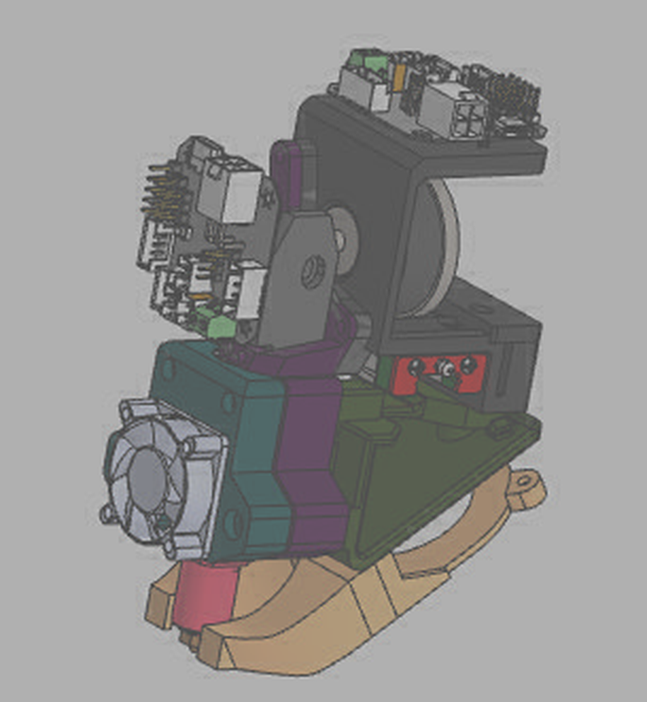

# Print head (Hefest) — review of the current design

Source: [KAPACbik/Hefest, branch `Side-PCB-test`](https://github.com/KAPACbik/Hefest/tree/Side-PCB-test), commit `5b11a37` (Nov 13, 2026). This folder holds the analysis only; the CAD files stay in that repository.

## What is in the repository

The head is designed in KOMPAS-3D v23 (educational version). History: 11 commits, Nov 8–13, 2026; `main` stops at Nov 9 and all later work is on `Side-PCB-test`.

**`Сборка/` (assembly)**

| File | What it is |
| :--- | :--- |
| `Сборка башки.a3d` | The head assembly (KOMPAS native). The `.bak`, `.bak.bak` and `.$$$` copies next to it are editor backups, about 90 MB of the repository. |
| `Рама.stp/.stl` | **Frame** — bolts on top of the MGN12H carriage, carries the extruder on a vertical plate, drops behind the rail to the belt clamp. 51×63×47 mm, 22.9 cm³. |
| `Крышка для ремня.stp/.stl` | **Belt cover** — clamps the belt ends from above with 2 × M3. 14×24×47 mm. |
| `Треугольник.stl` | **Triangle** — truss that passes under the X rail and ties the rear of the frame to the hotend mounts. |
| `Крепление хотенда 1.stl`, `2.stl` | **Hotend mounts** — two clamp halves for the CHC Pro; the front one carries the 3010 fan. |
| `Воздуховод.stp/.stl`, `Воздухан без углов.m3d` | **Part-cooling duct** from the 5015 blower, running under the rail to both sides of the nozzle. |

**`Компоненты/` (purchased parts and references):** 3010 fan, Artillery X4 Pro 5015 blower, BTT EBB42, BTT EBB36 Gen2 v1.1, BTT S2DW accelerometer, TriangleLab CHC Pro, E3D Volcano block, NEMA14 `14HR08-0654S`, MGN12H carriage, K3D Minifeeder mod 5A (Thingiverse 5773294), the stock green breakout board, duct tubes, a nut drawing.

The preview stored inside the assembly file shows the current state: two toolhead boards placed for comparison — one flat on a shelf above the extruder motor, one upright on the side next to the extruder.

Printed parts as exported: frame (blue), belt cover (orange), hotend mounts (green, purple), triangle (red), duct (yellow).

## Geometry read from the STEP files

Head coordinates: origin at the carriage centre, +Z along the X rail, +Y up, hotend on the −X side.

- **Carriage interface:** 4 holes on a 20×20 mm pattern (MGN12H), centred at x = −0.5, z = 0. The frame plate sits on the block at y = 9.
- **Belt clamp:** behind the rail, teardrop pockets at x = 15…21 with pins at z = ±10.5; the belt sits at y = −2…4. Both belt ends enter here, one from each side.
- **Extruder plate:** vertical, 2.5 mm thick with side ribs, 47 mm wide.

## Findings

1. **No corridor for a second belt run in front of the carriage.** The photos of the printer show a belt run on each side of the X rail. The frame clamps the run behind the rail; if the other run mirrors it in front of the rail (x ≈ −19), it passes through the front lip of the frame and the front bar of the triangle. The only gap there is about 2.5 mm high.

   

   White is free space along the whole head. The red box is the mirrored belt position — an assumption until the real belt positions are measured.

2. **Carriage screw holes.** The four holes are 2.7 mm with a 5.7 mm counterbore that leaves 1.7 mm of plastic under the screw head. M3 screws need 3.2–3.4 mm, and 1.7 mm is thin for the joint that carries the whole head.
3. **No model of the ordered board.** The repository has the first-generation EBB42 and an EBB36 Gen2, but not the EBB42 GEN2 V1.0 that was ordered. Its outline, hole pattern and XT30 position are needed before the board mount is fixed.
4. **Exports lag behind the assembly.** The STEP/STL files date from Nov 11; the assembly changed on Nov 13 (board moved up). Positions of the purchased parts exist only inside the `.a3d` file, which cannot be read outside KOMPAS.

## Needed to finalise the head

- **Belt positions on the printer:** distance from the rail centre to each belt run (front and back), height of the belt edges relative to the top of the rail, belt width, and whether the front run is attached to the current carriage or passes through freely.
- **A STEP export of the whole assembly** (`Сборка башки.a3d` → STEP), so every part is available in its real position for interference checks.
- **EBB42 GEN2 V1.0 model or dimensions** (board outline, mounting holes, connector positions).

## Tools

`tools/belt_corridor.py` projects any set of head STL files along the rail and reports how much of a given belt zone is blocked. The belt zone is a constant at the top of the script.
