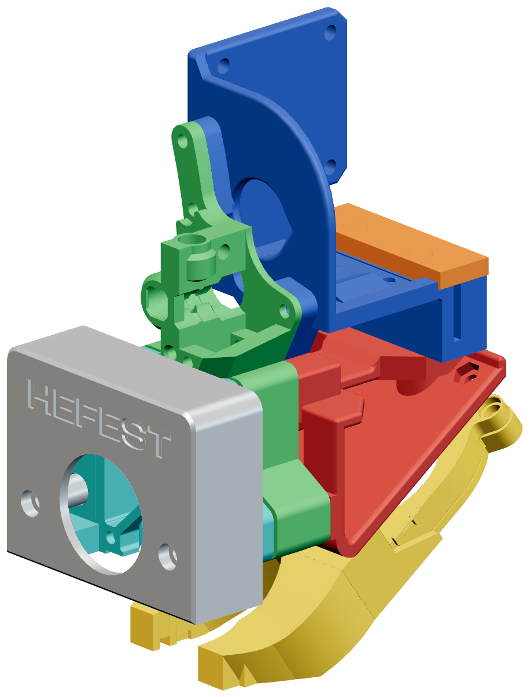
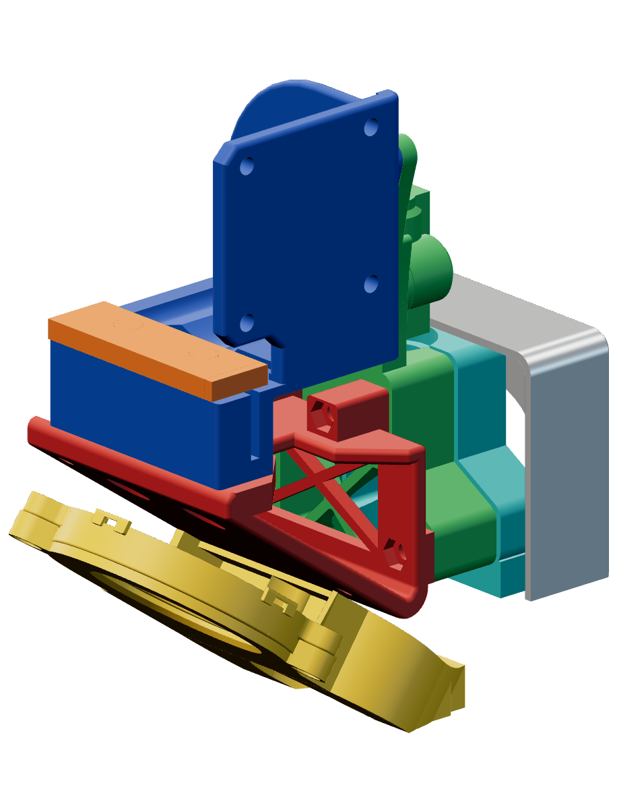
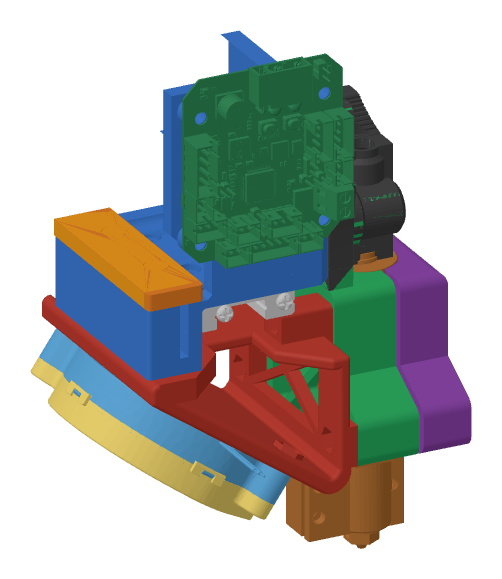
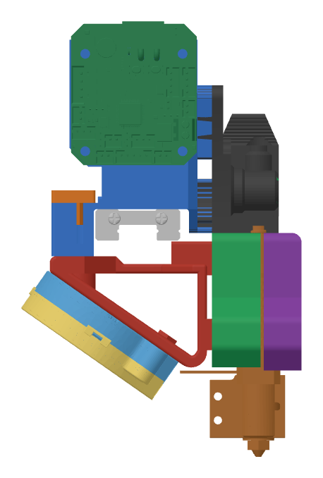

# Печатная голова Hefest — пояснительная записка

Печатная голова Hefest разработана командой «Печатники» для принтера Hefest — пересобранного Imprinta Hercules H18. Голова ставится на каретку MGN12H рельса оси X и несёт всё, что участвует в печати: экструдер, хотенд, обдув, плату головы и датчик стола.

*Печатные детали головы. Синий — рама, оранжевый — крышка ремня, красный — треугольник, зелёный и фиолетовый — крепления хотенда, жёлтый — воздуховод.*

## 1. Требования к голове

1. **Ставится на штатную механику.** Голова крепится к каретке MGN12H рельса X четырьмя винтами M3; рельсы, моторы осей и стол Hercules остаются на месте.
2. **Лёгкая и жёсткая.** Цель — скорость печати до 500 мм/с. Чем легче голова, тем быстрее её можно разгонять; чем она жёстче, тем меньше она раскачивается при разгоне и торможении.
3. **Не мешает ремням.** Концы ремней закрепляются на голове, свободная ветвь проходит мимо, не касаясь деталей.
4. **Под новую электронику.** Хотенд 24 В с нагревом до 300 °C, плата головы EBB42 GEN2 и один кабель от основной платы.
5. **Плата головы — сбоку, а не сверху** (раздел 4).

## 2. Печатные детали

| Деталь | Зачем нужна |
| :--- | :--- |
| **Рама** | Основа головы. Крепится к каретке MGN12H и несёт вертикальную плиту экструдера, зажим ремней и плату головы. Остальные детали держатся на раме, поэтому усилия от разгона передаются на каретку кратчайшим путём. Экструдер K3D Minifeeder встроен в плиту рамы — отдельный корпус ему не нужен. |
| **Крышка ремня** | Фиксирует концы ремней в зажиме на задней части рамы, крепится двумя винтами M3. Ремень держится без клея и стяжек; чтобы снять или перетянуть его, достаточно открутить два винта. |
| **Треугольник** | Ферма под рельсом X: связывает заднюю часть рамы с креплениями хотенда. Хотенд вынесен вперёд и вниз от каретки, и без фермы этот вынос раскачивался бы при разгоне — на стенках детали появлялись бы волны. Треугольная форма даёт жёсткость при малой массе. Между треугольником, рамой и кареткой оставлен проход для свободной ветви ремня. |
| **Крепления хотенда 1 и 2** | Две полуобоймы, которые зажимают радиатор хотенда CHC Pro и удерживают его вертикально. Передняя несёт вентилятор 3010, обдувающий радиатор. |
| **Воздуховод** | Подводит воздух от вентилятора 5015 под рельсом X к соплу с двух сторон. Деталь охлаждается равномерно, поэтому хватает одного вентилятора вместо двух. |

## 3. Покупные компоненты

| Компонент | Зачем нужен |
| :--- | :--- |
| **Хотенд TriangleLab CHC Pro** 24 В, 115 Вт, до 300 °C | Плавит пластик. Керамический нагреватель быстро выходит на температуру и держит её при большом расходе пластика, что нужно для высоких скоростей. Нагрев до 300 °C (у штатного UniHOT — до 260 °C) открывает инженерные пластики. Штатный термистор NTC 100K подключается к плате головы напрямую, без усилителя. |
| **Сопло TriangleLab Volcano NCB** | Биметаллическое сопло вместо латунного, которое быстро изнашивается; рассчитано на композиты — пластики с наполнителем. Удлинённый формат Volcano даёт длинную зону плавления, а значит, больший расход пластика. |
| **Экструдер K3D Minifeeder + шестерни BMG** редукция 5:1 | Подаёт пластик в хотенд. Экструдер прямой — стоит над хотендом, путь пластика от шестерён до сопла короткий, поэтому подача и откат точные, а Pressure Advance работает с малыми значениями. Редуктор позволяет лёгкому мотору развивать нужное усилие подачи. |
| **Мотор NEMA14, 36 мм** 98 г | Привод экструдера. Плоский мотор NEMA14 легче NEMA17, а недостающий момент добирает редуктор 5:1. Каждый грамм, снятый с головы, позволяет поднять ускорения. |
| **Плата головы BIGTREETECH EBB42 GEN2** | Собирает электронику головы в одном месте: драйвер мотора экструдера, акселерометр для Input Shaper, выходы нагревателя и вентиляторов, входы термистора и датчика стола. Вместо 12-жильного жгута к голове идёт один кабель: 24 В, GND и шина CAN. Выходы защищены от короткого замыкания, температуру платы контролирует Klipper. |
| **Датчик стола BIQU MicroProbe V2** | Автоматическая калибровка стола. Стол накрыт стеклом 4 мм, сквозь которое индуктивные и вихретоковые датчики не видят металл, поэтому выбран контактный датчик: он касается стекла металлическим штоком. Масса 6 г, повторяемость 0,002 мм. |
| **Вентилятор 5015** радиальный, 24 В | Обдув детали через воздуховод. Радиальный вентилятор создаёт давление, которое нужно, чтобы прогнать воздух через воздуховод. При высокой скорости слой должен застыть до того, как на него ляжет следующий, — без сильного обдува нависания и мосты провисают. |
| **Вентилятор 3010** 24 В | Охлаждает радиатор хотенда, чтобы пластик плавился только в зоне нагрева и не размягчался выше неё. Иначе в горле хотенда образуется пробка и подача останавливается. |
| **Каретка MGN12H** | Штатная, остаётся от Hercules. Голова спроектирована под её крепёжный квадрат 20 × 20 мм, поэтому ось X не переделывается. |
| **Винты и термовставки M3** | Латунные термовставки вплавляются в пластик и держат резьбу при многократной сборке лучше, чем резьба, нарезанная прямо в пластике. |

## 4. Плата головы на боковой стенке

Плата EBB42 GEN2 крепится к боковой стенке рамы, а не сверху головы:

- **голова не становится выше,** а её центр масс остаётся ближе к каретке — меньше опрокидывающий момент на каретку при резком разгоне;
- **верх головы свободен:** сверху в экструдер входит пластик, и к экструдеру остаётся доступ;
- **разъём XT30 направлен вверх,** и кабель уходит от головы вверх по кратчайшему пути;
- **рама легче:** полка под плату сверху больше не нужна — на 6 см³ меньше пластика.

Что изменено в раме (рама v2):

1. Убрана полка сверху головы.
2. Боковая стенка продлена в одну плоскую плиту под всю плату.
3. Добавлены четыре бобышки под латунные термовставки M3 по крепёжному квадрату платы 31 × 31 мм. Высота бобышек 3,5 мм — выводы на обратной стороне платы не касаются стенки.
4. Отверстия под винты каретки расширены до 3,4 мм — свободный проход винта M3.

На 3D-модели проверено, что стенка, бобышки и плата ни с чем в сборке головы не пересекаются, а крышку ремня можно снять, не снимая платы. При сборке на принтере остаётся проверить, что плата не задевает узел оси X в крайнем положении головы.

## 5. Нагрузка на кабель головы

Вся голова питается по одному кабелю 24 В через разъём XT30 платы EBB42 GEN2.

| Потребитель | Ток при 24 В |
| :--- | ---: |
| Нагреватель CHC Pro во время печати (45–65 Вт) | ≈ 2,3 А |
| Мотор экструдера NEMA14 | ≈ 0,35 А |
| Вентиляторы 5015 и 3010 | ≈ 0,25 А |
| **Итого во время печати** | **≈ 2,9 А** |
| Пик при холодном старте: нагреватель 115 Вт, первые 10–15 с | 5,44 А |
| Допустимый ток разъёма XT30 | 15 А |

Запас по разъёму — больше чем в 5 раз в рабочем режиме. Потери в кабеле — менее 0,44 Вт, нагрев драйвера экструдера на плате — около 0,29 Вт.

## 6. Файлы

- **3D-модель головы** — сборка и детали в STEP и STL: [KAPACbik/Hefest](https://github.com/KAPACbik/Hefest/tree/Side-PCB-test).
- **Рама v2 для печати** — [`v2/out/frame_v2.stl`](v2/out/frame_v2.stl), [`v2/out/frame_v2.step`](v2/out/frame_v2.step); габарит платы EBB42 GEN2 для проверки посадки — [`v2/out/ebb42_gen2_envelope.step`](v2/out/ebb42_gen2_envelope.step).
- **Построение рамы v2** — [`v2/frame_v2.py`](v2/frame_v2.py) (CadQuery) строит раму v2 из исходной; размеры размещения платы заданы константами в начале файла.
