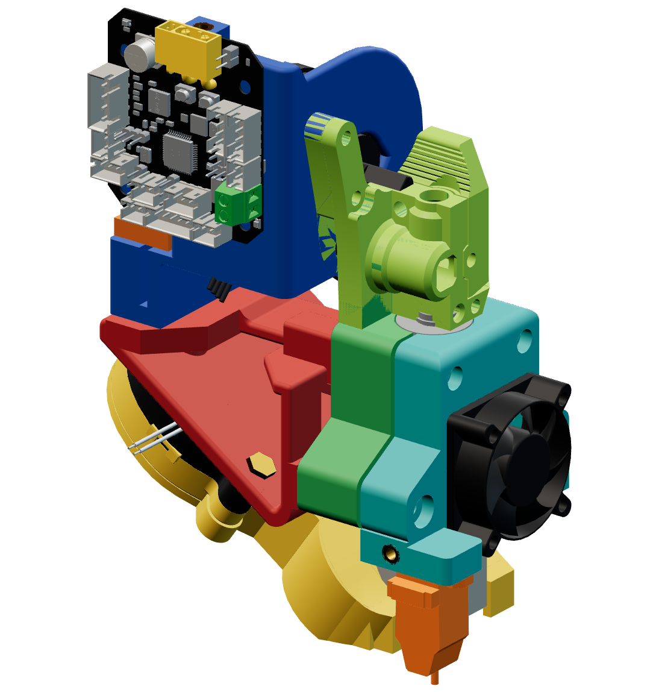
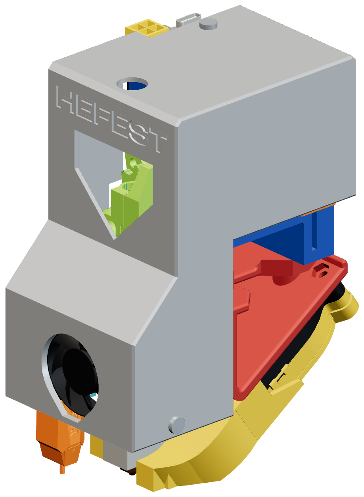
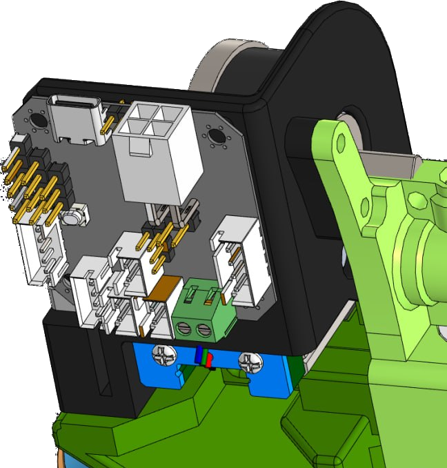
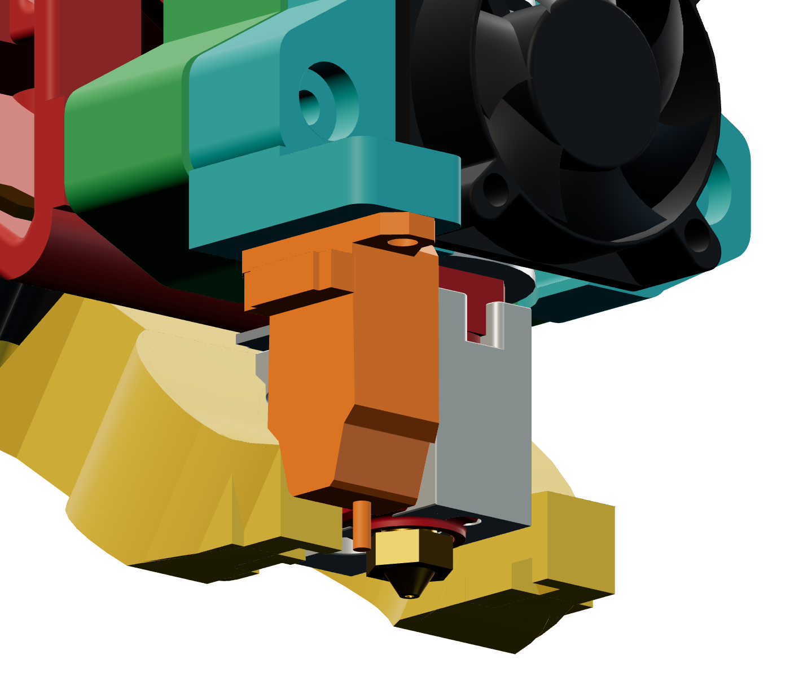
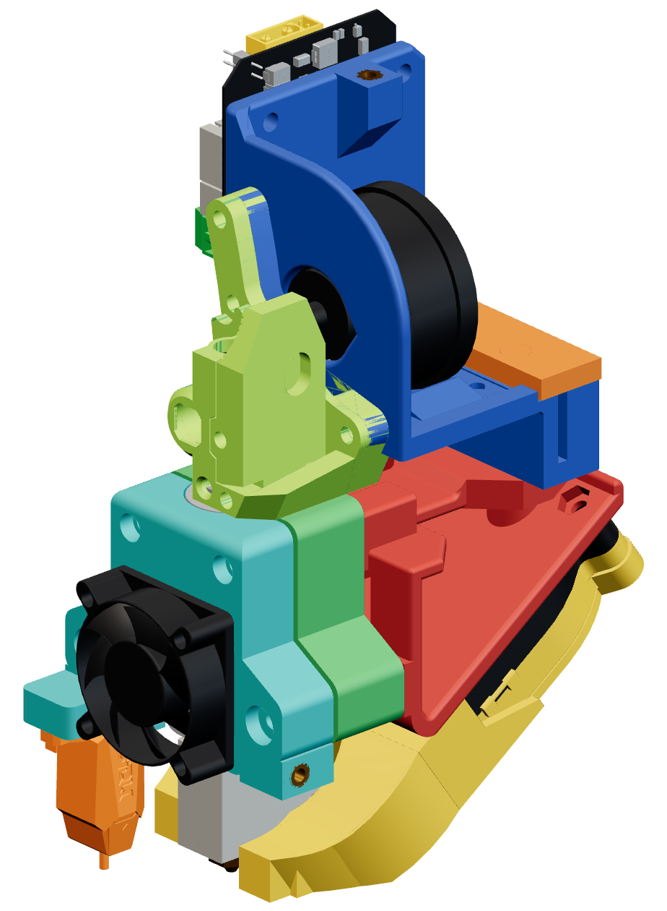
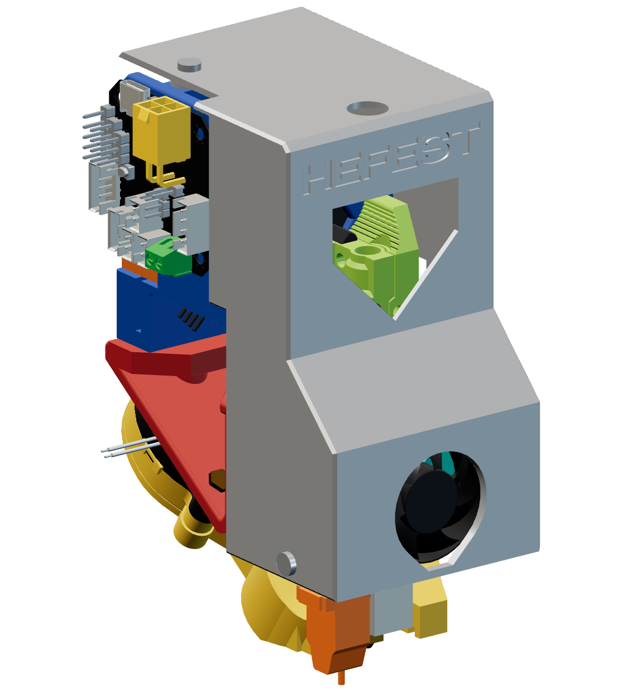
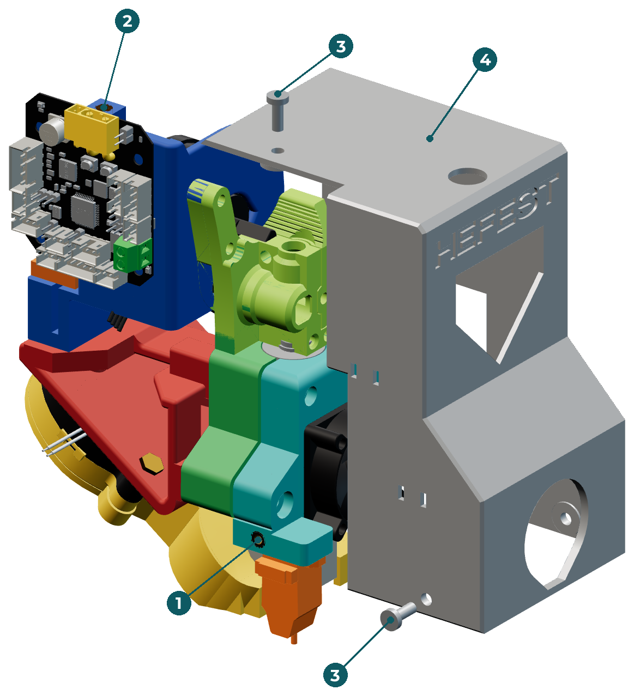

# Печатная голова Hefest - пояснительная записка

Печатная голова Hefest разработана командой «Печатники» для принтера Hefest - пересобранного Imprinta Hercules H18. Голова ставится на каретку MGN12H рельса оси X и несёт всё, что участвует в печати: экструдер, хотенд, обдув, плату головы и датчик стола.

*Печатная голова Hefest: слева без крышки, со стороны платы головы EBB42 GEN2 и вентилятора хотенда (оранжевым показан датчик стола MicroProbe), справа с крышкой, со стороны экструдера и мотора.*

## 1. Требования к голове

1. **Ставится на штатную механику.** Голова крепится к каретке MGN12H рельса X четырьмя винтами M3; рельсы, моторы осей и стол Hercules остаются на месте.
2. **Лёгкая и жёсткая.** Голова рассчитана на скорость печати до 500 мм/с. Чем легче голова, тем быстрее её можно разгонять; чем она жёстче, тем меньше она раскачивается при разгоне и торможении.
3. **Не мешает ремням.** Концы ремней закрепляются на голове, свободная ветвь проходит мимо, не касаясь деталей.
4. **Под новую электронику.** Хотенд 24 В с нагревом до 300 °C, плата головы EBB42 GEN2 и один кабель от основной платы.
5. **Плата головы - сбоку, а не сверху** (раздел 4).

## 2. Печатные детали

| Деталь | Зачем нужна |
| :--- | :--- |
| **Рама** | Основа головы. Крепится к каретке MGN12H и несёт вертикальную плиту экструдера, зажим ремней и плату головы. Остальные детали держатся на раме, поэтому усилия от разгона передаются на каретку кратчайшим путём. Экструдер K3D Minifeeder встроен в плиту рамы - отдельный корпус ему не нужен. |
| **Крышка ремня** | Фиксирует концы ремней в зажиме на задней части рамы, крепится двумя винтами M3. Ремень держится без клея и стяжек; чтобы снять или перетянуть его, достаточно открутить два винта. |
| **Треугольник** | Ферма под рельсом X: связывает заднюю часть рамы с креплениями хотенда. Хотенд вынесен вперёд и вниз от каретки, и без фермы этот вынос раскачивался бы при разгоне - на стенках детали появлялись бы волны. Треугольная форма даёт жёсткость при малой массе. Между треугольником, рамой и кареткой оставлен проход для свободной ветви ремня. |
| **Крепления хотенда 1 и 2** | Две полуобоймы, которые зажимают радиатор хотенда CHC Pro и удерживают его вертикально. Передняя несёт вентилятор 3010, обдувающий радиатор. Снизу на переднем креплении - посадочное место датчика стола MicroProbe (раздел 5). |
| **Воздуховод** | Подводит воздух от вентилятора 5015 под рельсом X к соплу с двух сторон. Деталь охлаждается равномерно, поэтому хватает одного вентилятора вместо двух. |
| **Крышка головы** | Закрывает голову спереди, сверху и с боков над рельсом X: вентилятор хотенда, крепления хотенда, экструдер, мотор и раму. Несёт название принтера. Крепится тремя собственными винтами M3 (раздел 5). |

## 3. Покупные компоненты

| Компонент | Зачем нужен |
| :--- | :--- |
| **Хотенд TriangleLab CHC Pro** 24 В, 115 Вт, до 300 °C | Плавит пластик. Керамический нагреватель быстро выходит на температуру и держит её при большом расходе пластика, что нужно для высоких скоростей. Нагрев до 300 °C (у штатного UniHOT - до 260 °C) открывает инженерные пластики. Штатный термистор NTC 100K подключается к плате головы напрямую, без усилителя. |
| **Сопло TriangleLab Volcano NCB** | Биметаллическое сопло вместо латунного, которое быстро изнашивается; рассчитано на композиты - пластики с наполнителем. Удлинённый формат Volcano даёт длинную зону плавления, а значит, больший расход пластика. |
| **Экструдер K3D Minifeeder + шестерни BMG** редукция 5:1 | Подаёт пластик в хотенд. Экструдер прямой - стоит над хотендом, путь пластика от шестерён до сопла короткий, поэтому подача и откат точные, а Pressure Advance работает с малыми значениями. Редуктор позволяет лёгкому мотору развивать нужное усилие подачи. |
| **Мотор NEMA14, 36 мм** 98 г | Привод экструдера. Плоский мотор NEMA14 легче NEMA17, а недостающий момент добирает редуктор 5:1. Каждый грамм, снятый с головы, позволяет поднять ускорения. |
| **Плата головы BIGTREETECH EBB42 GEN2** | Собирает электронику головы в одном месте: драйвер мотора экструдера, акселерометр для Input Shaper, выходы нагревателя и вентиляторов, входы термистора и датчика стола. Вместо 12-жильного жгута к голове идёт один кабель: 24 В, GND и шина CAN. Выходы защищены от короткого замыкания, температуру платы контролирует Klipper. |
| **Датчик стола BIQU MicroProbe V2** | Автоматическая калибровка стола. Стол накрыт стеклом 4 мм, сквозь которое индуктивные и вихретоковые датчики не видят металл, поэтому выбран контактный датчик: он касается стекла металлическим штоком. Масса 6 г, повторяемость 0,002 мм. Крепится снизу к переднему креплению хотенда двумя винтами M2,5 (раздел 5). |
| **Вентилятор 5015** радиальный, 24 В | Обдув детали через воздуховод. Радиальный вентилятор создаёт давление, которое нужно, чтобы прогнать воздух через воздуховод. При высокой скорости слой должен застыть до того, как на него ляжет следующий: без сильного обдува нависания и мосты провисают. |
| **Вентилятор 3010** 24 В | Охлаждает радиатор хотенда, чтобы пластик плавился только в зоне нагрева и не размягчался выше неё. Иначе в горле хотенда образуется пробка и подача останавливается. |
| **Каретка MGN12H** | Штатная, остаётся от Hercules. Голова спроектирована под её крепёжный квадрат 20 × 20 мм, поэтому ось X не переделывается. |
| **Винты и термовставки M3** | Латунные термовставки вплавляются в пластик и держат резьбу при многократной сборке лучше, чем резьба, нарезанная прямо в пластике. |

## 4. Плата головы на боковой стенке

Плата EBB42 GEN2 крепится к боковой стенке рамы, а не сверху головы:

1. **голова не становится выше,** а её центр масс остаётся ближе к каретке - меньше опрокидывающий момент на каретку при резком разгоне;
2. **верх головы свободен:** сверху в экструдер входит пластик, и к экструдеру остаётся доступ;
3. **разъём XT30 направлен вверх,** и кабель уходит от головы вверх по кратчайшему пути;
4. **рама легче:** полка под плату сверху больше не нужна - на 6 см³ меньше пластика.

*Плата EBB42 GEN2 на боковой стенке рамы.*

Что изменено в раме:

1. Убрана полка сверху головы.
2. Боковая стенка продлена в одну плоскую плиту под всю плату.
3. В стенке четыре отверстия диаметром 3,5 мм по крепёжному квадрату платы 31 × 31 мм. Плата отстоит от стенки на 3 мм, поэтому выводы на её обратной стороне (до 2,2 мм) стенки не касаются.

Размер платы EBB42 GEN2 - 40 × 45 мм, и крепёжный квадрат на ней смещён к нижнему краю: край с разъёмом XT30 отстоит от верхних отверстий на 9,6 мм, нижний край от нижних - на 4,4 мм. Поэтому на раме плата занимает по высоте от 21 до 66 мм и выступает над верхней гранью рамы на 5 мм, а разъём XT30 - на 5,9 мм. В сборке головы плата показана упрощённой моделью 40 × 40 мм; новые детали проверяются по настоящему контуру платы.

На 3D-модели проверено, что стенка и плата ни с чем в сборке головы не пересекаются, а крышку ремня можно снять, не снимая платы.

## 5. Датчик стола и крышка головы

### Датчик стола

Датчик BIQU MicroProbe V2 висит под передним креплением хотенда, со стороны платы головы, рядом с вентилятором хотенда. Шток датчика касается стола в 13,6 мм перед соплом и в 17,9 мм сбоку от него.

*Слева датчик стола (оранжевый) под передним креплением хотенда, справа голова без крышки со стороны экструдера.*

Что изменено в переднем креплении хотенда:

1. Под боковым выступом со стороны платы добавлен прилив с плоской нижней гранью - на неё ложится фланец датчика.
2. От прилива вперёд, вдоль вентилятора 3010, идёт консоль под второй винт датчика.
3. Снизу два глухих отверстия диаметром 2,2 мм и глубиной 5,5 мм с шагом 16,9 мм: винты M2,5 вкручиваются прямо в пластик. Подходят винты M2,5 × 5 из комплекта датчика (2,9 мм резьбы в пластике) и M2,5 × 6 (3,9 мм).
4. С другой стороны добавлен такой же прилив, а в боковой грани каждого прилива - отверстие под термовставку M3 для винта крышки.
5. Плоскости стыка с соседними деталями, посадка вентилятора и отверстия стяжных винтов не тронуты.

Высота посадки выбрана по соплу: убранный шток на 1,3 мм выше кончика сопла и не задевает деталь при печати, выдвинутый - на 1,5 мм ниже, срабатывание происходит на 1,0 мм ниже сопла. Посадка рассчитана на расстояние 71,2 мм от верхнего торца радиатора хотенда до кончика сопла и допускает отклонение этого размера до 1,0 мм в большую сторону и до 1,3 мм в меньшую. Регулировки по высоте у посадки нет: высота задаётся в модели одним числом - положением кончика сопла.

Крепление печатается задней плоскостью стыка на столе, консолью вверх. Полуотверстие под радиатор при этом обращено к столу, под него ставятся поддержки от стола.

Вокруг датчика оставлены зазоры: 1,2 мм до вентилятора хотенда, 7,4 мм до силиконового чехла нагревателя, 5,5 мм до воздуховода. Оба винта датчика доступны отвёрткой снизу, и датчик снимается вниз, не задевая соседних деталей.

### Подключение датчика

1. **Порт.** Датчик подключается к порту PROBE на нижнем крае платы EBB42 GEN2. Порядок контактов у датчика и у порта одинаковый, как у BLTouch: GND, питание, управление, GND, сигнал.
2. **Разъёмы.** У датчика пятиконтактный разъём с шагом 1,25 мм, у порта PROBE - пятиконтактный с шагом 2,0 мм (PH2.0), штекер вставляется перпендикулярно плате. На стороне платы кабель датчика должен оканчиваться штекером PH2.0.
3. **Питание 5 В.** Перемычка напряжения порта PROBE ставится в положение 5 В до подключения датчика: датчик рассчитан на 5 В, а второе положение перемычки подаёт на порт напряжение питания платы, 24 В.
4. **Сигнал.** Управление штоком - вывод PA4, сигнал срабатывания - вывод PA5. Сигнал на плате подтянут к напряжению порта резистором 4,7 кОм и проходит через оптопару; порт рассчитан на MicroProbe, BLTouch и индуктивные датчики. Оптопара переворачивает уровень, поэтому для MicroProbe V2, который при срабатывании даёт низкий уровень, вывод сигнала в Klipper задаётся без инверсии; правильность проверяется командой `QUERY_PROBE`.
5. **Трасса кабеля.** Разъём датчика смотрит наружу, в сторону платы головы. Кабель длиной 150 мм из комплекта датчика идёт от разъёма вверх по боковой стенке крышки, крепится к ней двумя стяжками и подходит к порту PROBE выше ремня; длина трассы около 135 мм. Прямая линия от датчика к порту пересекает переднюю ветвь ремня, поэтому кабель закреплён на стенке.
6. **Смещение для Klipper.** Шток датчика смещён от сопла на 17,9 мм вдоль оси X принтера, в сторону платы головы, и на 13,6 мм вперёд.

### Крышка головы

Крышка - одна деталь с названием принтера на лицевой стороне. Она надвигается на голову спереди и закрывает всё, что находится перед рельсом X и над ним: нос крышки прикрывает вентилятор и крепления хотенда, верхняя часть - экструдер, мотор и раму. Сзади крышка открыта.

*Слева голова с крышкой. Справа крепление крышки: 1 - термовставки M3 в приливах переднего крепления хотенда (по одной с каждой стороны), 2 - термовставка M3 в бобышке рамы, 3 - винты M3 × 8, 4 - крышка надвигается спереди.*

Крепление крышки:

1. У крышки свои три винта M3 × 8 с полукруглой головкой, стяжные винты головы для неё не используются.
2. Два винта входят сбоку, сквозь боковые стенки крышки, в термовставки в приливах переднего крепления хотенда. Отверстия под эти термовставки глубиной 7,5 мм: винт входит в прилив на 5,6 мм и не упирается в дно.
3. Третий винт входит сверху в термовставку в бобышке рамы. Бобышка добавлена на внутренней стороне боковой стенки рамы, у верхнего края; её нижняя грань скошена под 45°.
4. Под винтами в крышке сделаны опорные площадки, чтобы стенка не прогибалась при затяжке.
5. Под крышку заново печатаются две детали: рама с бобышкой и переднее крепление хотенда с приливами.

Что оставлено открытым:

1. Окно перед экструдером - рычаг прижима и шестерни видны и доступны без снятия крышки.
2. Сторона платы EBB42 GEN2: плата с разъёмами и проводами стоит снаружи крышки и охлаждается как раньше.
3. Паз в верхней стенке над всей платой и отверстие 10 мм под пруток. Плата выше крышки: её верхний край проходит сквозь паз и выступает над крышкой на 1,3 мм, разъём XT30 - на 2,1 мм.
4. Всё, что ниже нижнего края: датчик стола с консолью и кабелем, сопло, воздуховод. Датчик снимается без снятия крышки.
5. Зона рельса и ремней: боковые стенки заканчиваются над ними. Часть головы под рельсом (треугольник и вентилятор 5015) не закрыта: одной деталью с крышкой её закрыть нельзя, а вентилятору нужен приток воздуха.

В боковой стенке со стороны платы сделаны две пары прорезей 1,8 × 4 мм под стяжки. Ими крепятся кабель датчика стола и провода хотенда, которые идут к плате по этой стенке; за стенкой в этих местах не меньше 12 мм свободного места.

Крышка рассчитана на печать без поддержек, верхней стенкой на столе:

1. В этом положении все стенки вертикальны, габарит на столе 95 × 61 мм, высота 109 мм.
2. Нос вырастает из передней стенки по скосу 45°, нижний край окна экструдера и вырез под вентилятор сходятся под 45°.
3. Изнутри ничего не свисает: опорные площадки выступают на 0,6 мм, дно гравировки - на 0,8 мм.
4. Самый длинный мостик - 7,3 мм над вырезом вентилятора; прорези под стяжки - мостики по 1,8 мм.
5. Стенки 1,6 мм (четыре периметра соплом 0,4 мм), передняя стенка носа 2,4 мм.

Крышка увеличивает габарит головы: вперёд на 3,6 мм дальше вентилятора, вбок со стороны экструдера на 2,4 мм и ещё 1,7 мм на головку винта. По высоте габарит не меняется: верх крышки на 3,8 мм выше рамы и на 2,1 мм ниже разъёма XT30 платы.

На 3D-модели проверено, что изменённые детали, датчик с выдвинутым штоком, штекер его кабеля, крышка и её винты ни с чем в сборке головы не пересекаются, в том числе с платой EBB42 GEN2 в её настоящих размерах, а в модели крышки нет нависаний, которым нужна поддержка.

## 6. Нагрузка на кабель головы

Вся голова питается по одному кабелю 24 В через разъём XT30 платы EBB42 GEN2.

| Потребитель | Ток при 24 В |
| :--- | ---: |
| Нагреватель CHC Pro во время печати (45-65 Вт) | ≈ 2,3 А |
| Мотор экструдера NEMA14 | ≈ 0,35 А |
| Вентиляторы 5015 и 3010 | ≈ 0,25 А |
| **Итого во время печати** | **≈ 2,9 А** |
| Пик при холодном старте: нагреватель 115 Вт, первые 10-15 с | 5,44 А |
| Допустимый ток разъёма XT30 | 15 А |

Запас по разъёму - больше чем в 5 раз в рабочем режиме. Потери в кабеле - менее 0,44 Вт, нагрев драйвера экструдера на плате - около 0,29 Вт.

## 7. Файлы

- **3D-модель головы** - сборка и детали в STEP и STL: [KAPACbik/Hefest](https://github.com/KAPACbik/Hefest/tree/Side-PCB-test).
- **Рама v3** - [`v3/out/frame_v3.stl`](v3/out/frame_v3.stl), [`v3/out/frame_v3.step`](v3/out/frame_v3.step): актуальная рама из KAPACbik/Hefest, четыре отверстия крепления платы уменьшены с 3,8 до 3,5 мм. Строится скриптом [`v3/frame_v3.py`](v3/frame_v3.py).
- **Рама v3 с бобышкой под крышку** - [`v3/out/frame_v3_cover.stl`](v3/out/frame_v3_cover.stl), [`v3/out/frame_v3_cover.step`](v3/out/frame_v3_cover.step); печатается вместо рамы v3, если ставится крышка. Скрипт [`v3/frame_cover.py`](v3/frame_cover.py).
- **Переднее крепление хотенда с местом под MicroProbe и приливами под крышку** - [`v3/out/hotend_mount_2_probe.stl`](v3/out/hotend_mount_2_probe.stl), [`v3/out/hotend_mount_2_probe.step`](v3/out/hotend_mount_2_probe.step); печатается вместо «Крепление хотенда 2». Скрипт [`v3/mount2_probe.py`](v3/mount2_probe.py), положение датчика задано в [`v3/probe.py`](v3/probe.py): высота посадки считается от кончика сопла `NOZZLE`.
- **Крышка головы** - [`v3/out/head_cover.stl`](v3/out/head_cover.stl), [`v3/out/head_cover.step`](v3/out/head_cover.step); скрипт [`v3/cover.py`](v3/cover.py), точки крепления - [`v3/cover_points.py`](v3/cover_points.py). Печатать верхней стенкой на столе, без поддержек.
- **Проверки** - [`v3/check_fit.py`](v3/check_fit.py) сверяет новые детали, датчик, винты крышки и плату EBB42 GEN2 в настоящих размерах ([`v3/board.py`](v3/board.py)) со всей сборкой головы, [`v3/print_check.py`](v3/print_check.py) ищет в крышке нависания, которым нужна поддержка.
- **Рама v2** (предыдущий вариант, с бобышками под термовставки) - [`v2/out/frame_v2.stl`](v2/out/frame_v2.stl), [`v2/out/frame_v2.step`](v2/out/frame_v2.step), скрипт [`v2/frame_v2.py`](v2/frame_v2.py).
